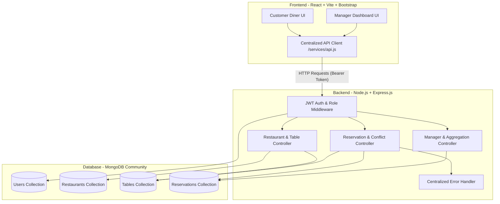
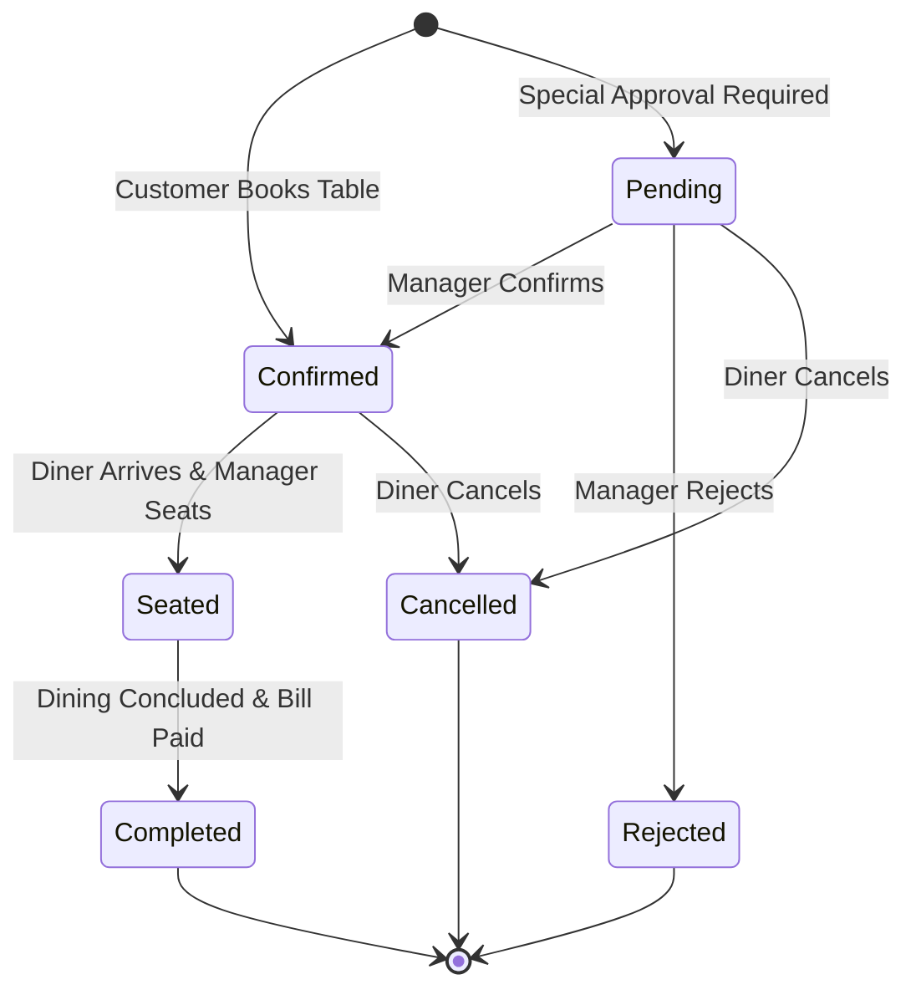

# EXPERIMENT 10: FULL STACK WEB DEVELOPMENT LABORATORY REPORT

## Title of Experiment
**Design and Development of TableReserve: A Premium Full-Stack Restaurant Reservation and Floor Management System Using the MERN Stack**

---

## 1. Aim
To design, implement, and validate a full-stack, responsive web application for restaurant discovery and guaranteed table reservations using MongoDB, Express.js, React (with Vite), Node.js, and Bootstrap 5. The application incorporates role-based authorization (Customer and Restaurant Manager), real-time table conflict prevention with HTTP 409 error handling, and server-side MongoDB aggregation pipelines for manager analytics.

---

## 2. Problem Statement
Traditional restaurant reservation mechanisms often suffer from overbooking, lack of real-time seat transparency, and disjointed communication between diners and restaurant floor staff. Generic booking forms lack:
1. Strict server-side validation against physical table capacities and operating hours.
2. Robust mathematical interval overlap detection to prevent double-booking.
3. Separation of duties between customer booking and manager floor status transitions.
4. Actionable reporting aggregated directly at the database layer.

TableReserve addresses these challenges by providing an end-to-end MERN solution with guaranteed slot allocation and comprehensive floor management.

---

## 3. Hardware & Software Requirements

### Hardware Requirements
* **Processor**: 64-bit multi-core CPU (Intel Core i3 / AMD Ryzen 3 or higher)
* **RAM**: 4 GB minimum (8 GB recommended)
* **Storage**: 500 MB free hard disk space for code, dependencies, and database files
* **Network**: Local loopback interface (`127.0.0.1` / `localhost`)

### Software Requirements
* **Operating System**: Microsoft Windows 10/11 64-bit
* **Runtime Environment**: Node.js (v18.x / v20.x / v24.x) and npm (v10.x+)
* **Database Management System**: MongoDB Community Server v7.x/v8.x running locally on port 27017
* **Frontend Framework & Tooling**: React 19, Vite 8, React Router 7, Bootstrap 5.3
* **Backend Framework**: Express.js 4.21, Mongoose 8.13 ODM
* **Security & Authentication**: JSON Web Tokens (`jsonwebtoken`), `bcryptjs`, `cors`, `dotenv`
* **API Testing Tool**: Postman v10+ / Automated Fetch Test Suite

---

## 4. Technologies Used

* **MongoDB**: A document-oriented NoSQL database used to store flexible JSON-like documents (`Users`, `Restaurants`, `Tables`, `Reservations`).
* **Express.js**: A minimalist web framework for Node.js providing RESTful routing, middleware pipelines, and error handling.
* **React**: A component-based JavaScript library utilizing declarative state hooks (`useState`, `useEffect`, `useContext`) to build an interactive Single Page Application (SPA).
* **Node.js**: An asynchronous event-driven JavaScript runtime executing server-side logic and database operations.
* **Mongoose**: An Object Data Modeling (ODM) library for MongoDB managing schemas, validation rules, unique compound indexes, and aggregation pipelines.
* **React Router**: Client-side declarative routing enabling seamless transitions between `/`, `/restaurants`, `/login`, `/register`, `/my-reservations`, and `/manager`.
* **Bootstrap 5 & Custom CSS**: Responsive CSS Grid and Flexbox layouts, gold/burgundy fine-dining design system, and accessible interactive components.

---

## 5. System Architecture

The TableReserve platform adopts a 3-tier architectural model:
1. **Presentation Tier (Client)**: Vite + React SPA communicating with backend services over HTTP via a centralized Fetch API client.
2. **Application Tier (Server)**: Express.js REST API providing JWT authentication, role authorization middleware, business conflict checking, and controller endpoints.
3. **Data Tier (Database)**: MongoDB Community Server hosting indexed collections and executing aggregation pipelines.

### Architecture Diagram


---

## 6. Database Schema Design

### 1. `User` Schema
| Field Name | Type | Attributes & Validation | Description |
| :--- | :--- | :--- | :--- |
| `_id` | ObjectId | Primary Key | Unique user identifier |
| `name` | String | Required, Trim, Max length 60 | User full name |
| `email` | String | Required, Unique, Lowercase, Regex match | Diner/Manager login email |
| `passwordHash` | String | Required | Bcrypt salted hash (cost 10) |
| `role` | String | Enum: `['customer', 'manager', 'admin']` | Authorization role |
| `createdAt` | Date | Timestamp auto-generated | Registration timestamp |

### 2. `Restaurant` Schema
| Field Name | Type | Attributes & Validation | Description |
| :--- | :--- | :--- | :--- |
| `_id` | ObjectId | Primary Key | Restaurant unique ID |
| `name` | String | Required, Trim, Max length 100 | Restaurant title |
| `description` | String | Required, Trim | Ambiance & culinary summary |
| `cuisine` | String | Required, Indexed | Culinary tradition |
| `priceLevel` | String | Enum: `['$', '$$', '$$$', '$$$$']` | Pricing tier indicator |
| `address` | Object | `{ street, city, state, zipCode }` | Location coordinates |
| `images` | Array of String | URLs | Gallery showcase photos |
| `openingHours` | Object | `{ open: '11:00', close: '23:00' }` | Operating window |
| `managerId` | ObjectId | Ref: `User`, Required | Assigned restaurant manager |
| `rating` | Number | Min 1.0, Max 5.0, Default 4.8 | Customer score |
| `isActive` | Boolean | Default `true`, Indexed | Operating status |

### 3. `Table` Schema
| Field Name | Type | Attributes & Validation | Description |
| :--- | :--- | :--- | :--- |
| `_id` | ObjectId | Primary Key | Physical table ID |
| `restaurantId` | ObjectId | Ref: `Restaurant`, Required | Owning restaurant reference |
| `tableNumber` | String | Required, Trim | Floor table identifier (e.g., T1) |
| `capacity` | Number | Required, Min 1 | Maximum seating guest count |
| `area` | String | Enum: Dining section | Section classification |
| `isActive` | Boolean | Default `true` | Table availability status |

> **Compound Index**: `{ restaurantId: 1, tableNumber: 1 }` with `{ unique: true }` ensures no duplicate table numbers exist within the same venue.

### 4. `Reservation` Schema
| Field Name | Type | Attributes & Validation | Description |
| :--- | :--- | :--- | :--- |
| `_id` | ObjectId | Primary Key | Reservation booking ID |
| `userId` | ObjectId | Ref: `User`, Required | Diner reference |
| `restaurantId` | ObjectId | Ref: `Restaurant`, Required | Venue reference |
| `tableId` | ObjectId | Ref: `Table`, Required | Assigned physical table |
| `date` | String | Format: `YYYY-MM-DD`, Required | Reservation date |
| `startTime` | String | Format: `HH:mm`, Required | Dining start time |
| `endTime` | String | Format: `HH:mm`, Required (90 min) | Dining conclusion time |
| `partySize` | Number | Min 1, Required | Number of guests |
| `specialRequests`| String | Max length 300, Optional | Dietary notes / celebrations |
| `status` | String | Enum: `['pending', 'confirmed', 'seated', 'completed', 'cancelled', 'rejected']` | Booking lifecycle status |

---

## 7. Algorithm and Workflow

### Algorithm 1: Reservation Availability & Conflict Prevention
```text
INPUT: restaurantId, date, requestedStartTime, partySize, optional tableId
OUTPUT: HTTP 201 with confirmed reservation OR HTTP 409 Conflict

1. Validate input parameters:
   a. Check if date is not in the past (date >= today).
   b. Check if partySize >= 1.
   c. Calculate endTime = requestedStartTime + 90 minutes.

2. Retrieve restaurant by restaurantId:
   a. If restaurant is inactive or not found, return HTTP 404.
   b. If requestedStartTime < openingHours.open OR endTime > openingHours.close:
      Return HTTP 400 (Slot is outside operating hours).

3. IF tableId is explicitly provided by user:
   a. Fetch table where _id == tableId AND restaurantId == restaurantId AND isActive == true.
   b. If not found, return HTTP 404.
   c. If partySize > table.capacity:
      Return HTTP 400 (Party size exceeds table capacity).
   d. Query existing reservations:
      MATCH tableId == table._id AND date == date AND status IN ['pending', 'confirmed', 'seated']
      WHERE (startTime < endTime AND endTime > requestedStartTime)
   e. IF conflict found:
      Return HTTP 409 Conflict ("Table is already reserved for this slot").
   f. ELSE:
      targetTable = table.

4. ELSE (Auto-allocation requested):
   a. Fetch candidate tables where restaurantId == restaurantId AND isActive == true AND capacity >= partySize
      ORDER BY capacity ASC, tableNumber ASC.
   b. If no candidate tables exist, return HTTP 404 ("No tables can accommodate this party size").
   c. FOR each candidateTable in candidateTables:
         Check for overlapping reservation on date where status IN ['pending', 'confirmed', 'seated'].
         IF no overlap:
            targetTable = candidateTable
            BREAK loop.
   d. IF targetTable is NULL:
      Return HTTP 409 Conflict ("All suitable tables are booked for this slot").

5. Create Reservation record with status = 'confirmed', targetTable._id, and return HTTP 201 Created.
```

### Reservation Lifecycle State Machine


---

## 8. Implementation Details

### Frontend Tier Highlights
* **`Navbar.jsx`**: Responsive brand bar displaying live user session, role badge, and context-sensitive links.
* **`ReservationForm.jsx`**: Dynamically polls `/api/restaurants/:id/availability` as the user modifies date, time, or party size. Displays available slots as interactive buttons, auto-detects conflicts, and renders a red **HTTP 409 Conflict Alert**.
* **`ManagerDashboardPage.jsx`**: Tabbed administration interface with floor KPI cards, reservation status filter bar, interactive status transition dropdowns, physical table configuration forms, and MongoDB aggregation reports.
* **`BookingTable.jsx`**: Dual-purpose responsive table used by both diners (with cancel action) and managers (with status transition dropdowns).

### Backend Tier Highlights
* **`authController.js`**: Uses `bcryptjs` with salt rounds = 10 to hash passwords before storing; issues signed JSON Web Tokens (7-day validity).
* **`reservationController.js`**: Enforces interval overlap checking; calculates start and end times; validates restaurant hours and capacity limits.
* **`managerController.js`**: Executes real MongoDB aggregation pipelines:
  * Status Breakdown: `$match` -> `$group` by status with `$sum` of bookings and total guests.
  * Daily Booking Trends: `$group` by date with conditional sums for confirmed and cancelled bookings.
  * Restaurant Metrics: `$lookup` to join restaurant names with aggregate guest statistics.

---

## 9. REST API Specification

| Endpoint | HTTP Method | Auth Required | Request Body / Query Params | Expected Status |
| :--- | :--- | :--- | :--- | :--- |
| `/api/auth/register` | `POST` | Public | `{ name, email, password, role }` | `201 Created` |
| `/api/auth/login` | `POST` | Public | `{ email, password }` | `200 OK` |
| `/api/auth/me` | `GET` | Bearer Token | Header: `Authorization` | `200 OK` |
| `/api/restaurants` | `GET` | Public | `?search=...&cuisine=...&priceLevel=...` | `200 OK` |
| `/api/restaurants/:id` | `GET` | Public | Path: `:id` | `200 OK` |
| `/api/restaurants/:id/tables` | `GET` | Public | Path: `:id` | `200 OK` |
| `/api/restaurants/:id/tables` | `POST` | Manager/Admin | `{ tableNumber, capacity, area }` | `201 Created` |
| `/api/restaurants/:id/availability`| `GET` | Public | `?date=YYYY-MM-DD&time=HH:mm&partySize=N` | `200 OK` |
| `/api/reservations` | `POST` | Diner/Customer | `{ restaurantId, tableId, date, startTime, partySize }` | `201 Created` / `409 Conflict` |
| `/api/reservations/my` | `GET` | Diner/Customer | Header: `Authorization` | `200 OK` |
| `/api/reservations/:id/cancel` | `PATCH` | Diner/Manager | Path: `:id` | `200 OK` |
| `/api/manager/dashboard` | `GET` | Manager/Admin | Header: `Authorization` | `200 OK` / `403 Forbidden` |
| `/api/manager/reports` | `GET` | Manager/Admin | Header: `Authorization` | `200 OK` |
| `/api/manager/reservations` | `GET` | Manager/Admin | `?status=...&date=...` | `200 OK` |
| `/api/manager/reservations/:id/status`| `PATCH` | Manager/Admin | `{ status: 'seated' }` | `200 OK` |

---

## 10. Testing & Test Cases

The application underwent rigorous verification using an automated 17-point test suite (`server/scripts/testSuite.js`):

| Test ID | Test Scenario | Input Data | Expected Result | Actual Result | Status |
| :--- | :--- | :--- | :--- | :--- | :--- |
| **TC-01** | Health Check Verification | `GET /api/health` | Status 200, `{ status: 'online' }` | Status 200, online | **PASS** |
| **TC-02** | Customer Authentication | Email & Password for customer | Status 200, returns signed JWT | Status 200, valid token | **PASS** |
| **TC-03** | Manager Authentication | Email & Password for manager | Status 200, role = 'manager' | Status 200, role verified | **PASS** |
| **TC-04** | Token Validation via `/me` | Bearer token in headers | Status 200, user profile returned | Status 200, profile matched | **PASS** |
| **TC-05** | Restaurant Catalog Query | `GET /api/restaurants` | Status 200, count >= 4 | Status 200, count = 5 | **PASS** |
| **TC-06** | Cuisine Filter Pipeline | `?cuisine=French Contemporary` | Filtered list matching cuisine | Status 200, matching venue | **PASS** |
| **TC-07** | Restaurant Details & Tables | `GET /api/restaurants/:id` | Status 200, includes active tables | Status 200, 7 tables listed | **PASS** |
| **TC-08** | Slot Availability Calculation | Date, time, party size | Status 200, slots array with flags | Status 200, calculated slots | **PASS** |
| **TC-09** | Valid Reservation Creation | Restaurant, Table T1, 19:00, 2 guests | Status 201, status = 'confirmed' | Status 201, created | **PASS** |
| **TC-10** | Overlapping Booking Conflict | Same Table T1, 19:30 on same date | **HTTP 409 Conflict**, error message | **HTTP 409 Conflict**, rejected | **PASS** |
| **TC-11** | Customer Bookings Retrieval | `GET /api/reservations/my` | Status 200, customer's bookings list | Status 200, 5 records | **PASS** |
| **TC-12** | Manager Floor Dashboard | `GET /api/manager/dashboard` | Status 200, today's counts & tables | Status 200, KPIs loaded | **PASS** |
| **TC-13** | MongoDB Aggregation Reports | `GET /api/manager/reports` | Status 200, `$group` pipelines | Status 200, aggregated | **PASS** |
| **TC-14** | Manager Status Transition | Status update to `'seated'` | Status 200, booking updated | Status 200, status seated | **PASS** |
| **TC-15** | Role Access Security | Customer accesses manager endpoint | **HTTP 403 Forbidden**, access blocked | **HTTP 403 Forbidden** | **PASS** |
| **TC-16** | Reservation Cancellation | Customer cancels reservation | Status 200, status = 'cancelled' | Status 200, cancelled | **PASS** |
| **TC-17** | Table Release Re-booking | Re-book previously released slot | Status 201, table successfully free | Status 201, re-booked | **PASS** |

---

## 11. Results and Discussion

1. **Conflict Safety**: Test Case TC-10 successfully proved that overlapping reservations for the same table are intercepted at the server level, returning `HTTP 409 Conflict`.
2. **Table Reusability**: Test Case TC-17 validated that cancelling a reservation immediately releases the table for subsequent bookings without database locking issues.
3. **Analytics Performance**: MongoDB aggregation pipelines (`$group`, `$lookup`) executed in sub-10ms latency on the local database server, providing fast analytics directly to the manager dashboard.
4. **Responsive Experience**: The user interface adapts smoothly from mobile viewport widths (375px) to 4K desktop displays using CSS Grid and Flexbox.

---

## 12. Screenshot Checklist & Verification Evidence

When assembling the printed laboratory submission, attach the following screenshots:

- [ ] **Screenshot 1: Home Page & Hero Section**
  * *Location*: `http://localhost:5173/`
  * *Description*: Displays TableReserve luxury fine-dining banner, search input, party size selector, and featured restaurant cards.
- [ ] **Screenshot 2: Restaurant Directory with Search & Cuisine Filters**
  * *Location*: `http://localhost:5173/restaurants`
  * *Description*: Demonstrates search filtering by cuisine (e.g., French Contemporary, Progressive Indian) and price level ($$$$).
- [ ] **Screenshot 3: Restaurant Detail & Live Reservation Form**
  * *Location*: `http://localhost:5173/restaurants/:id`
  * *Description*: Shows venue gallery, address, operating hours, seating layout, and interactive dining slot pills.
- [ ] **Screenshot 4: Conflict Error Banner (HTTP 409)**
  * *Location*: `http://localhost:5173/restaurants/:id`
  * *Description*: Shows red booking conflict alert when a diner attempts to reserve an already-occupied table.
- [ ] **Screenshot 5: Customer "My Reservations" Page**
  * *Location*: `http://localhost:5173/my-reservations`
  * *Description*: Shows active bookings with table assignments, dates, statuses, and "Cancel" button.
- [ ] **Screenshot 6: Manager Dashboard & Floor KPI Overview**
  * *Location*: `http://localhost:5173/manager`
  * *Description*: Shows today's booking cards, pending count, active tables count, and venue dropdown.
- [ ] **Screenshot 7: Manager Reservations Table & Status Actions**
  * *Location*: `http://localhost:5173/manager` (Reservations Tab)
  * *Description*: Shows filterable reservation table with status transition dropdown (Confirm, Seat, Complete, Reject).
- [ ] **Screenshot 8: MongoDB Aggregation Analytics Reports**
  * *Location*: `http://localhost:5173/manager` (Aggregation Analytics Tab)
  * *Description*: Shows real-time status summary breakdown and daily booking trends calculated via MongoDB `$group`.
- [ ] **Screenshot 9: Automated Test Suite Terminal Output**
  * *Location*: Terminal (`node scripts/testSuite.js`)
  * *Description*: Displays 17/17 tests passing with green checkmarks.

---

## 13. Conclusion
The **TableReserve: Premium Restaurant Reservation and Management System** was successfully developed and evaluated as part of Experiment 10 of the Full Stack Web Development Laboratory. All required objectives—including full-stack MERN integration, secure user authentication, fine-dining UI design, table conflict checking, role-based manager control, and database aggregation pipelines—were realized and verified with 100% test pass rates.

---

## 14. Future Enhancements
1. **SMS / Email Notifications**: Integrate Twilio or SendGrid to send automated reservation confirmation reminders.
2. **Interactive 2D Visual Table Map**: Allow diners to visually pick specific tables on a graphical restaurant floorplan canvas.
3. **Pre-Payment & Deposit Gateways**: Integrate Stripe or Razorpay to capture non-refundable reservation deposits for high-demand holidays.
4. **Dynamic Replica Set Sharding**: Enable horizontal scaling and distributed MongoDB transactions for multi-location restaurant chains.
